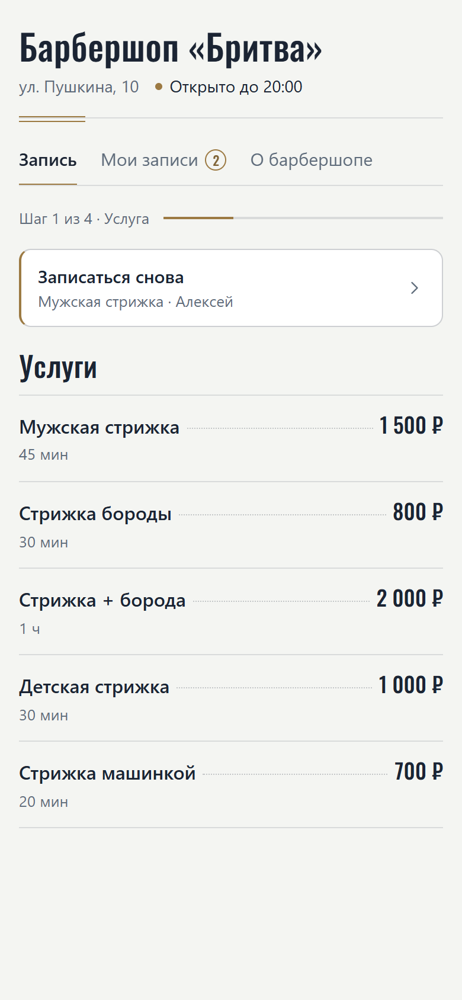
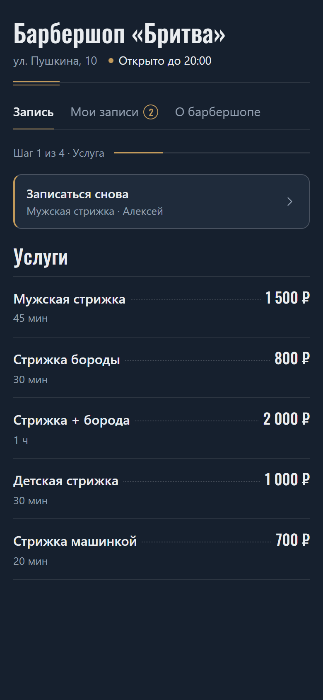
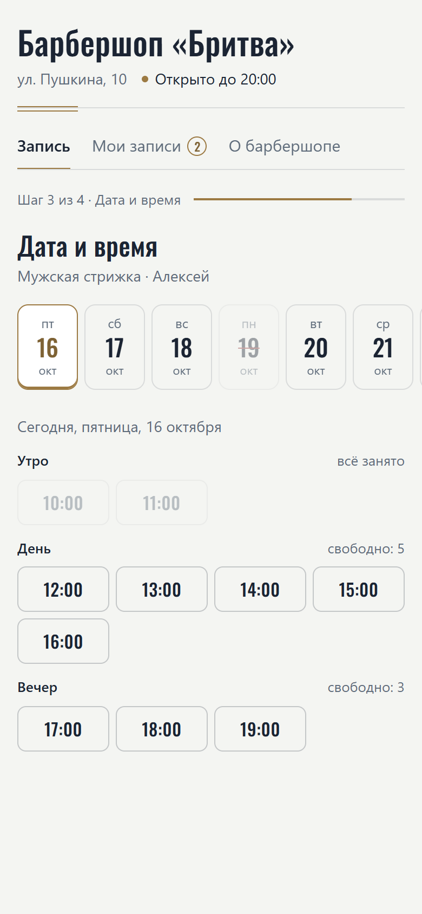
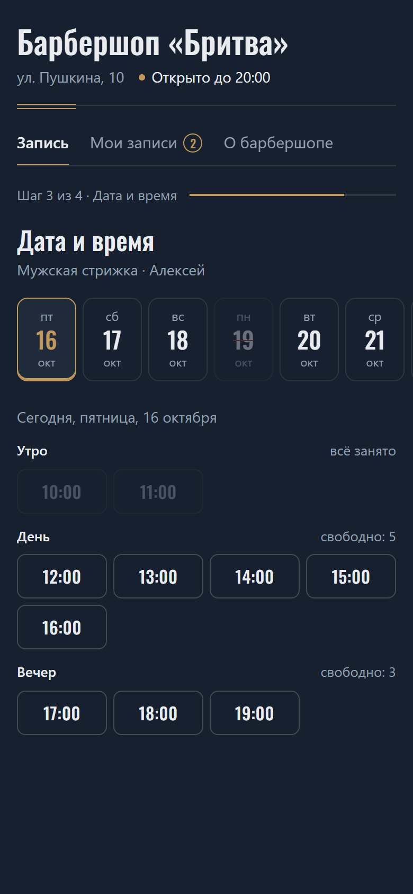
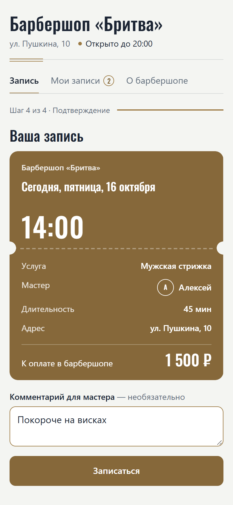
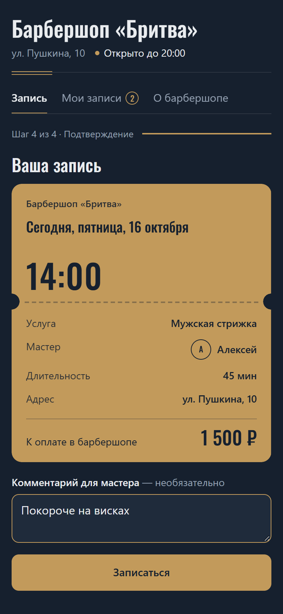
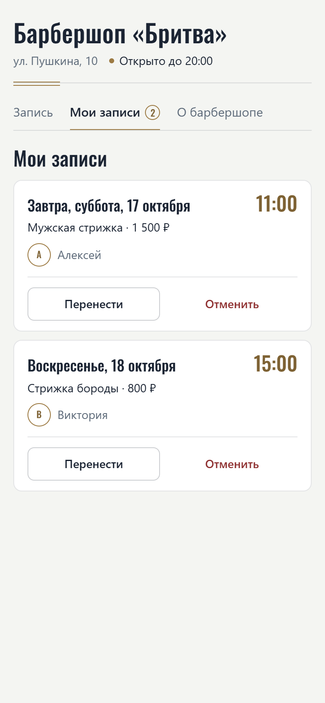
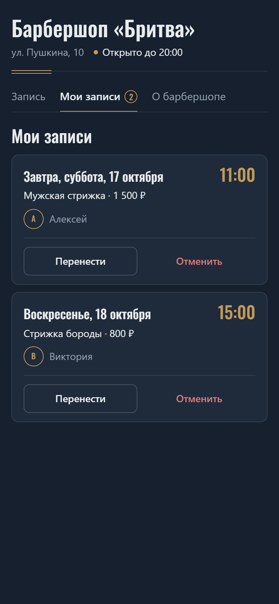
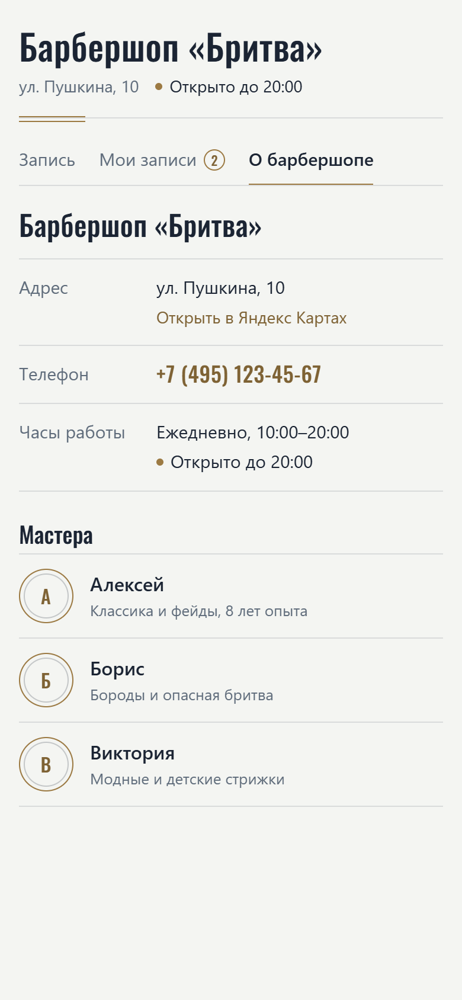
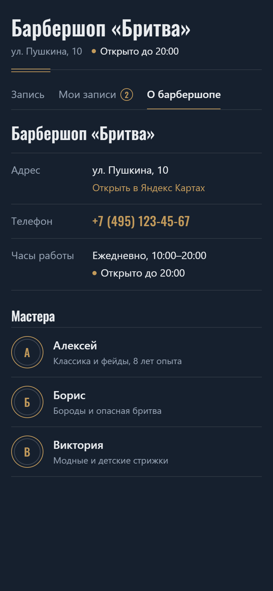

# Мини-приложение для записи в барбершоп

Учебное Telegram Mini App: клиент записывается к мастеру, переносит и отменяет свои записи, смотрит
адрес и часы работы барбершопа, а страница отправляет его действие боту
([barbershop-bot](https://github.com/seniawer/barbershop-bot)).
Это одна статическая страница (`index.html`, `style.css`, `app.js`) без сборки и без серверной части.
Услуги, мастеров, расписание и записи клиента страница получает от бота в адресе, поэтому её не нужно
править при смене цен, услуг или мастеров.

## Как это работает

Вверху — шапка: название барбершопа, адрес и статус «Открыто до 20:00» (или «Закрыто · откроется в 10:00»)
по часам работы. Под ней три раздела.

### Запись

1. **Услуга** — прайс-лист: название слева, цена справа, между ними отточие, длительность мелко под названием.
   Над списком — «Записаться снова»: услуга и мастер из последней записи клиента, кнопка сразу ведёт
   к выбору времени.
2. **Мастер** — «Любой мастер» отдельной строкой (к кому записать, решает бот), ниже мастера:
   монограмма-инициалы в тонком латунном кольце, имя, специализация и сколько свободных часов на неделе.
   Мастер без свободного времени недоступен.
3. **Дата и время** — дни лентой (сразу открыт ближайший день со свободным временем), время сеткой
   по группам «Утро / День / Вечер». Занятое и прошедшее время видно, но выбрать его нельзя.
4. **Талон записи** — дата, время, услуга, мастер, длительность, адрес и стоимость. Ниже —
   необязательный «Комментарий для мастера» (до 200 символов). Кнопка «Записаться · цена» —
   это `Telegram.WebApp.MainButton`, возврат на предыдущий шаг — `Telegram.WebApp.BackButton`.

### Мои записи

Будущие записи клиента (их присылает бот). У каждой — «Перенести» и «Отменить».
Перенос — на другое время у того же мастера: та же лента дней и сетка времени, текущее время записи
отмечено «сейчас», кнопка «Перенести на ...» — `MainButton`. Отмена — после подтверждения
(`Telegram.WebApp.showConfirm`). Бот может открыть страницу сразу на этом разделе (параметр `t=my`).

### О барбершопе

Адрес со ссылкой «Открыть в Яндекс Картах» (`Telegram.WebApp.openLink`), телефон (ссылка `tel:`),
часы работы со статусом и список мастеров.

## Скриншоты

Демо-данные, ширина экрана 390 px. Тема выбирается по теме Telegram у клиента.

<table>
  <tr><th>Светлая тема</th><th>Тёмная тема</th></tr>
  <tr><td colspan="2" align="center"><b>Запись: прайс-лист услуг и «Записаться снова»</b></td></tr>
  <tr>
    <td></td>
    <td></td>
  </tr>
  <tr><td colspan="2" align="center"><b>Выбор дня и времени: прошедшее и занятое время выбрать нельзя</b></td></tr>
  <tr>
    <td></td>
    <td></td>
  </tr>
  <tr><td colspan="2" align="center"><b>Талон записи с комментарием для мастера</b></td></tr>
  <tr>
    <td></td>
    <td></td>
  </tr>
  <tr><td colspan="2" align="center"><b>Мои записи: перенос и отмена</b></td></tr>
  <tr>
    <td></td>
    <td></td>
  </tr>
  <tr><td colspan="2" align="center"><b>О барбершопе: адрес, телефон, часы работы и мастера</b></td></tr>
  <tr>
    <td></td>
    <td></td>
  </tr>
</table>

## Дизайн

Цвета у страницы свои, не из `themeParams`: тема Telegram (`colorScheme`) только выбирает светлую
или тёмную палитру, а вне Telegram — `prefers-color-scheme`. Шапка и фон окна Telegram и `MainButton`
перекрашиваются в те же цвета (`setHeaderColor`, `setBackgroundColor`, `setBottomBarColor`,
`MainButton.setParams`). Все цвета — CSS-переменные в начале `style.css`.

| | Тёмная | Светлая |
|---|---|---|
| Фон | `#16202E` | `#F4F5F2` |
| Поверхности | `#1F2B3B` | `#FFFFFF` |
| Текст | `#E9ECEF` | `#1B2433` |
| Вторичный текст | `#93A0B1` | `#5E6B7A` |
| Латунь (акцент) | `#C29A5B` | `#9C7A43` |
| Ошибки и занятое | `#9E3B3B` | `#8E2F2F` |

Контраст текста проверен по WCAG (4,5:1 для обычного текста). Отсюда несколько уточнений:

- тёмная тема: `#9E3B3B` на фоне даёт всего 2,5:1, поэтому он используется для линий и заливок,
  а текст ошибки — светлее, `#E07A7A` (4,9:1 к поверхности);
- светлая тема: латунь `#9C7A43` на фоне — 3,6:1, этого хватает для колец, линий и крупных цифр,
  а мелкий латунный текст — темнее, `#7E6234` (5,2:1);
- талон и `MainButton` — единственные яркие элементы: в тёмной теме латунь `#C29A5B` с тёмным текстом
  (6,3:1), в светлой — латунь `#86683A` с белым текстом (5,2:1).

Шрифт Oswald (Google Fonts, с кириллицей, `display=swap`) — для названия, заголовков, цен, дат и времени,
остальной текст — системным шрифтом. Анимация только в ответ на действия пользователя (переход между
шагами, появление талона); при `prefers-reduced-motion: reduce` её нет. Вёрстка рассчитана на телефоны
шириной 320–430 px.

При изменении `app.js` или `style.css` увеличьте версию `?v=...` в `index.html`, иначе Telegram
может показать старую версию из кэша.

## Данные от бота

Бот передаёт всё одним параметром адреса `d` — JSON в UTF-8, закодированный в base64url без `=`:

```
https://<логин>.github.io/<репозиторий>/?d=eyJ2IjoxLCJkIjoiMjAyNi0xMC0xMSIs...&t=my
```

Внутри — компактный JSON с короткими ключами, чтобы адрес оставался коротким
(с тремя мастерами, пятью услугами и парой записей клиента — около 1200 символов):

```json
{
  "v": 1,
  "d": "2026-10-16",
  "n": 7,
  "h": [10, 19],
  "s": [["haircut", "Мужская стрижка", 1500, 45], ["beard", "Стрижка бороды", 800, 30]],
  "m": [["alex", "Алексей", "Классика и фейды", [0, 6, 0, 1023, 0, 0, 0]]],
  "b": ["Барбершоп «Бритва»", "ул. Пушкина, 10", "+7 (495) 123-45-67", "Москва, ул. Пушкина, 10"],
  "u": [[42, "haircut", "alex", "2026-10-17", "11:00"]],
  "l": ["haircut", "alex"]
}
```

| Ключ | Что значит |
|------|-----------|
| `v` | Версия формата (сейчас 1) |
| `d` | Первый день записи `ГГГГ-ММ-ДД` (по часам сервера бота) |
| `n` | Сколько дней показывать |
| `h` | Первый и последний час записи. Часы работы на странице: с `h[0]`:00 до `h[1] + 1`:00 |
| `s` | Услуги: `[код, название, цена, минуты]`. Минуты (длительность) необязательны |
| `m` | Мастера: `[id, имя, описание, занятость]`. Занятость — по числу на каждый из `n` дней, битовая маска часов: бит 0 — первый час (`h[0]`), бит 1 — следующий и т. д. Например, `6` = биты 1 и 2 = 11:00 и 12:00 заняты, `1023` — заняты все 10 часов. Нерабочее и закрытое мастером время бот тоже передаёт как занятое |
| `b` | Необязательно: `[название, адрес, телефон, запрос для Яндекс Карт]`. Телефон и запрос можно не передавать — тогда нет строки телефона, а карты ищут по адресу |
| `u` | Необязательно: будущие записи клиента `[id, код услуги, id мастера, дата, время]` для «Моих записей» |
| `l` | Необязательно: `[код услуги, id мастера]` последней записи для «Записаться снова» |

Параметр `t` (необязательно): `my` или `about` — открыть сразу этот раздел.

Если параметра `d` нет или он испорчен, в Telegram страница показывает сообщение «Не удалось загрузить
расписание», а в обычном браузере открывается с демо-данными. Незнакомые услуги и мастера в `u` и `l`
пропускаются.

## Что получает бот

Страница вызывает `Telegram.WebApp.sendData` со строкой JSON. Поле `action` — что сделать:

| `action` | Пример |
|----------|--------|
| `book` — запись | `{"action":"book","service":"haircut","master":"boris","date":"2026-10-17","time":"11:00","comment":"покороче"}` |
| `cancel` — отмена | `{"action":"cancel","id":42}` |
| `reschedule` — перенос | `{"action":"reschedule","id":42,"date":"2026-10-18","time":"15:00"}` |

`master` — id мастера или `any` («Любой мастер»), `comment` — только если клиент его написал.
Цену страница не отправляет: бот берёт её из своего списка. Бот получает строку в сообщении в поле
`web_app_data.data`. После отправки Telegram сам закрывает мини-приложение.

> **Важно.** `sendData` работает, только если страница открыта через обычную кнопку клавиатуры
> (`KeyboardButton` с полем `web_app`). Если открыть её через инлайн-кнопку, отправить данные не получится:
> страница это определяет, прячет кнопки подтверждения, переноса и отмены и показывает предупреждение.

## Проверка локально

Вне Telegram страница работает в демо-режиме: вверху появляется пометка, кнопки «Назад», «Записаться»
и «Перенести» показываются прямо на странице, а после действия на экран выводится JSON, который
получил бы бот. В демо-данных есть две записи для «Моих записей» и последняя запись для «Записаться снова».

Запустите любой простой веб-сервер в папке проекта, например:

```bash
python -m http.server 8000
```

Откройте в браузере:

- http://localhost:8000/ — с встроенными демо-данными (пять услуг, три мастера, две записи);
- http://localhost:8000/?t=my или ?t=about — сразу нужный раздел;
- http://localhost:8000/?d=... — с настоящими данными: возьмите адрес, который собирает бот
  (функция `miniapp_url` в `bot.py`), и замените в нём начало на `http://localhost:8000/`.

Светлую и тёмную тему в браузере переключает тема системы (`prefers-color-scheme`), а в инструментах
разработчика Chrome — «Rendering → Emulate CSS media feature prefers-color-scheme».

## Публикация на GitHub Pages

1. Создайте репозиторий на GitHub и отправьте в него файлы проекта:
   ```bash
   git add .
   git commit -m "Мини-приложение для записи в барбершоп"
   git branch -M main
   git remote add origin https://github.com/<логин>/<репозиторий>.git
   git push -u origin main
   ```
2. В репозитории откройте **Settings → Pages**.
3. В разделе **Build and deployment** выберите **Source: Deploy from a branch**,
   ветку `main` и папку `/ (root)`, нажмите **Save**.
4. Через минуту-две страница будет доступна по адресу `https://<логин>.github.io/<репозиторий>/`.
   GitHub Pages работает по HTTPS, а Telegram только с таким адресом и открывает мини-приложения.

Этот адрес (с параметром `d`) бот указывает в `KeyboardButton` с `web_app`.
Страницу и бота нужно обновлять вместе: формат данных в адресе и в `sendData` у них общий.

## Безопасность

В проекте нет токенов, ID и других секретов: страница ничего не знает о боте и только отправляет
действие через `sendData`. Токен бота хранится только у бота. Бот сам ещё раз проверяет всё: услугу,
мастера, что время свободно и рабочее, а при отмене и переносе — что запись принадлежит именно этому
клиенту: данные со страницы (и параметр `d` в адресе) может подменить кто угодно. Имена, описания,
адрес и телефон из адреса страница выводит только как текст (`textContent`), поэтому HTML в них
не выполнится; ссылка на карты собирается на самой странице только на `yandex.ru/maps`, а в ссылке
`tel:` остаются только цифры и `+`.
